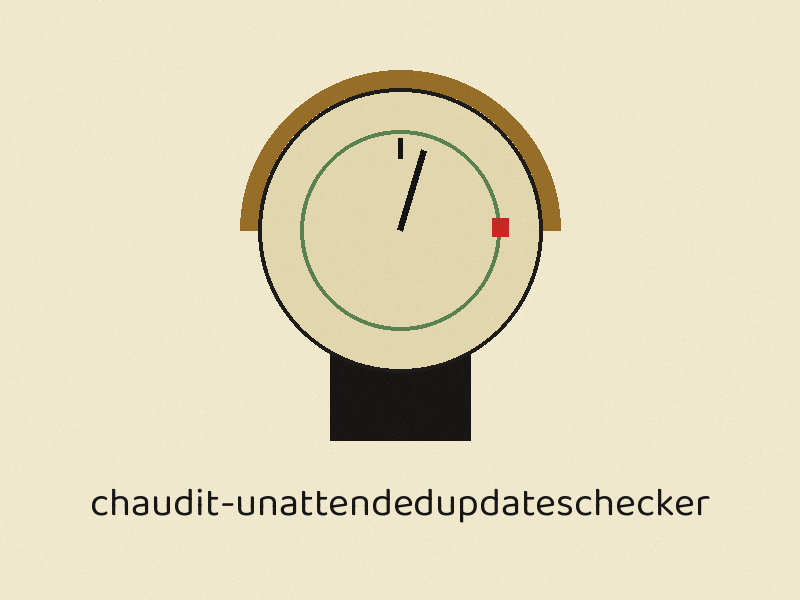

> Ship's log treatment noted first: a ruled log entry, Baloo Da 2 in iron black on sand.

# chaudit-unattendedupdateschecker

# chaudit-UnattendedUpdatesChecker
A simple script to check if unattended upgrades are enabled and configured correctly on Debian and Ubuntu systems, reporting on the status and any misconfigurations. It runs one dpkg -s check for the unattended-upgrades package and reads the two apt configuration files /etc/apt/apt.conf.d/50unattended-upgrades and /etc/apt/apt.conf.d/20auto-upgrades. It can also validate a YAML or JSON configuration file against a JSON schema supplied by the user. No predefined schema or rule set ships with this tool.

## Install

> Deviation card: Wrong Yard on the Sign. The clone line above names ShadowStrikeHQ; this repository lives under ShadowGuard-AI. The line is preserved as published and flagged here, not corrected in place.

`git clone https://github.com/ShadowStrikeHQ/chaudit-unattendedupdateschecker`

## Usage

> Deviation card: the usage line above names a file that does not exist in the repository. The entry point in the code is main.py, run with python3.

`./chaudit-unattendedupdateschecker [params]`

## Parameters

> Deviation card: Both Files or Neither. The two file arguments must be given together in the code, and the description for --config-file comes from the parser in main.py, where the list above leaves it as published.

- `-h`: Show help message and exit
- `--check-upgrades`: Check unattended upgrades status.
- `--config-file`: No description provided
- `--schema-file`: Path to the JSON schema file.

## License
Copyright (c) ShadowStrikeHQ
